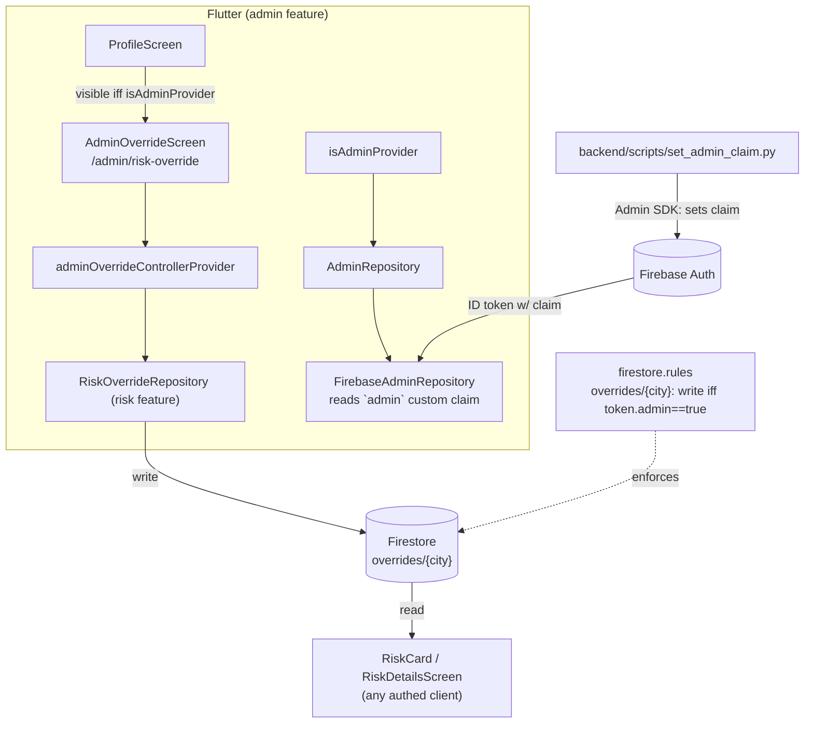

# Module 8 — Admin & Analytics Panel: Read-Only Engineering Audit

**Type:** Historical pre-implementation audit

For current implementation, tests and remaining deployment work, see [Module 8 engineering report](MODULE_8_FINALIZATION.md).
**Scope:** Entire repository — Flutter app, `backend/`, Firestore rules, deployment scripts, documentation
**Prior modules:** Module 6 (AI/ML Engine) and Module 7.0–7.5 (Personalized Alert System) are complete. Module 7.6 (medication-context targeting) is paused. This audit starts Module 8.

---

## 1. Executive Summary

Module 8 is **~15% built**. What exists is a single, well-engineered slice — the manual risk override (SDS FR8.2) — built and hardened in Sprint 5 Prompt 13, plus its two supporting operator primitives (job heartbeats, ops CLI scripts) built in Sprint 5 Prompt 12. Everything else the SDS specifies for Module 8 — the system-metrics dashboard (FR8.1), content management (FR8.3), admin activity logs (FR8.4), and the entire user-management screen (FR8.5) — **does not exist in any form**, not even as a stub screen or an unused Firestore collection.

This is not accidental scope creep left undone; it is a **documented, deliberate deprioritization**. An internal planning document already on this branch (`docs/sprint-6/ForeSeeMe_Sprint6_Playbook.md`, written before this audit) explicitly evaluated the admin surface and demoted a "heartbeat dashboard / cloud job monitoring" screen to *Nice to Have*, reduced to a single read-only status view, on the reasoning that billing/live infrastructure isn't running and evaluator exposure is low. That plan was never executed (no `PH-32b` commit exists), so even that reduced scope is unbuilt.

The good news for a from-scratch Module 8 sprint: the **hard security work is already done**. The `admin` custom-claim pattern, the fail-closed client gate, and the Firestore rule shape for admin-only writes are proven in production code and covered by tests. A user-management screen, a metrics dashboard, and a CMS can all reuse this exact pattern rather than inventing a new one.

The project's foundational docs (`docs/project-context.md`, `docs/progress.md`, `docs/roadmap.md`, `docs/database.md`, `docs/known-issues.md`) are frozen at a very early MVP snapshot and **contradict the current, far more advanced codebase** (they don't mention `riskEstimates`, `overrides`, `jobHeartbeats`, `userAlerts`, or any Sprint 3–5 feature). This is real, pre-existing documentation drift — flagged in §9 — and this audit does not treat those files as authoritative for current state.

---

## 2. Current Module 8 Architecture

```
lib/features/admin/
├── domain/repositories/admin_repository.dart        # AdminRepository (pure interface)
├── data/repositories/firebase_admin_repository.dart # reads `admin` custom claim from ID token
└── presentation/
    ├── admin_providers.dart        # isAdminProvider, AdminOverrideController
    └── admin_override_screen.dart  # the ONLY admin screen

test/features/admin/risk_override_test.dart          # covers all of the above + RiskCard overlay
```

The override *feature logic* (model, repository, read providers) actually lives in the **risk** feature, not admin, because risk surfaces are the consumers:

```
lib/features/risk/domain/models/risk_override.dart
lib/features/risk/domain/repositories/risk_override_repository.dart
lib/features/risk/data/repositories/firestore_risk_override_repository.dart
lib/features/risk/presentation/risk_override_provider.dart
lib/features/risk/presentation/widgets/risk_override_notice.dart
```

Route: `/admin/risk-override` (`lib/core/routes/app_router.dart:264`) is a single flat `GoRoute`, reachable only via a link on `ProfileScreen` — there is no `/admin` shell, no nested admin routes, no admin navigation.



Backend surface relevant to Module 8: **none**. `backend/app/main.py` exposes exactly two routes, `GET /health` and `POST /predict` (internal, model-serving only). There is no `/admin/*`, `/stats/*`, or `/metrics` HTTP endpoint. All existing "admin tooling" is either a Firestore security rule + custom claim, or a one-off Python CLI script run by a human operator (`backend/scripts/set_admin_claim.py`, `backend/deploy/read_heartbeat.py`, `backend/deploy/read_dispatch_audit.py`) — none of these are reachable from the app or any HTTP surface.

No Firebase Functions exist in the repo (`functions/` does not exist) — all backend logic is FastAPI + Cloud Run scheduled jobs (`backend/app/jobs/*`), consistent with ADR-002.

---

## 3. SDS Compliance Review (requirement-by-requirement)

The SDS defines Module 8 twice: a short top-level FE list, and a detailed FR table derived from mockups M13 ("Admin Dashboard & Control Panel") and M14 ("User Management Screen"). The FR table is the operative spec (docs/ForeSeeMe SDS final(SP23-BSE-034 & 040).docx.md:977-1012). Findings below are against the FR table.

| SDS Requirement | Status | Evidence |
|---|---|---|
| **FE-1 / FR8.1** — System monitoring dashboard: active users, alert count, model version, last run time | **Missing** | No screen, no route, no aggregation query anywhere. Raw ingredients exist but are not exposed: `jobHeartbeats/{job}` (job status/last-run, `backend/app/jobs/observability.py`) and `GET /health` (`modelVersion`, `backend/app/main.py:61-68`) exist but are **service-account/internal only** — `firestore.rules:107-109` denies ALL client read/write on `jobHeartbeats`, and `/health` is not called from the Flutter app at all (GOLDEN_RULES §4 forbids the app from calling the backend directly for risk; nothing calls `/health` either). Active-user count and alert-volume count have **no source at all** — no collection or query anywhere counts users or alerts. |
| **FR8.2** — Manual risk override (city, disease, level, justification, logged) | **Complete** | `lib/features/admin/**`, `lib/features/risk/domain/models/risk_override.dart`, `firestore.rules:87-101`, `docs/admin_override.md`. City/disease/level selection + required `reason` field + author/timestamp audit fields, enforced server-side via `admin` custom claim. Tested end-to-end in `test/features/admin/risk_override_test.dart` and `test_rules/firestore_rules.test.mjs`. |
| **FR8.3** — Content management form for Health Resource Center articles | **Missing (by design, currently)** | `lib/features/resources/domain/repositories/resource_repository.dart:4-14` states explicitly: *"Content ships with the app (no backend)"*. Articles are static Dart data, not Firestore documents. There is no CRUD path, no upload workflow, no admin-only edit surface, no versioning/publishing. Building FR8.3 as specified requires first migrating resource content off static Dart and into Firestore — a data-layer change, not just a new screen. |
| **FR8.4** — Admin activity log (overrides + content updates, immutable, timestamped) | **Missing** | Each `overrides/{city}` document *does* carry per-write audit fields (`authorUid`, `authorEmail`, `createdAt`, `reason`), but because a new write **supersedes** the previous document (`docs/admin_override.md:22`, "a new write supersedes the previous one"), there is no append-only history — clearing/re-setting an override does not preserve prior overrides as a queryable log. There is no UI to view any log, and no log exists for content updates (since FR8.3 doesn't exist). |
| **FR8.5** — User management (list/search/filter/view/suspend/reactivate/delete/add, status indicators, admin action logging) | **Missing, entirely** | No `users` listing query exists anywhere (client-side or backend). `firestore.rules:23-29` scopes `users/{userId}` reads strictly to the owner (`request.auth.uid == userId`) — an admin has **no rule path to read another user's document today**; this is a security-rule gap that must be deliberately added (not just a missing screen) before any admin UI could list users. No suspend/block/delete mechanism exists at any layer (Firebase Auth has `disabled` account state, but nothing in this repo sets it). |

**Bottom line:** 1 of 5 FR8.x requirements (FR8.2) is complete. FR8.1 has partial raw data (inaccessible to any admin surface). FR8.3, FR8.4, FR8.5 have zero implementation.

---

## 4. Implementation Status — What Already Exists (reusable for Module 8)

These aren't Module 8 deliverables themselves, but they are exactly the primitives Module 8 needs and should reuse rather than reinvent:

1. **Admin authorization pattern** — `admin` Firebase custom claim, set only via `backend/scripts/set_admin_claim.py` (Admin SDK, never client-settable), read client-side via `FirebaseAdminRepository.isCurrentUserAdmin()` with a forced token refresh, exposed as `isAdminProvider` (fails closed to `false` on any error). This is the correct, provable pattern for FR8.1/8.3/8.4/8.5 gating too.
2. **Firestore admin-write rule shape** — `overrides/{city}` rule (`request.auth.token.get('admin', false) == true`) is a template for any new admin-writable collection (content, user status flags).
3. **Job observability data** — `jobHeartbeats/{job}` already contains `status`, `ok`, `startedAt`, `finishedAt`, `durationMs`, `total`, `counts`, `error` for all three scheduled jobs (`compute_risk`, `dispatch_alerts`, `weekly_report`). This is most of FR8.1's "last run time" / "model version" / job-health needs — it just needs an admin-gated read path.
4. **Dispatch audit trail** — `alertDispatchLog` (service-account only, `firestore.rules:31-36`) already records per-run dispatch outcomes; could seed an admin "alert volume" metric for FR8.1 with an added admin read rule.
5. **CLI ops tooling** (not a panel, but genuine hidden/undocumented-to-users admin capability): `backend/scripts/set_admin_claim.py` (grant/revoke), `backend/deploy/read_heartbeat.py`, `backend/deploy/read_dispatch_audit.py`, `backend/scripts/seed_risk_estimates.py`. These are developer/operator-run Python scripts, not reachable from the app — they satisfy "existing admin utilities" but not any in-app FR.
6. **A prior planning artifact for admin scope** — `docs/sprint-6/ForeSeeMe_Sprint6_Playbook.md` §2.3 and its roadmap's `PH-32b` already scoped a minimal "System Status" read-only screen (heartbeat freshness + last N audit entries, RBAC-gated) as a Nice-to-Have. It was never built. This is a ready-made, already-reviewed starting spec for FR8.1 if the team wants to reuse it rather than re-plan from zero.

## 5. Missing Components (what genuinely needs to be built)

- **FR8.1 dashboard**: an admin-gated read path to `jobHeartbeats` (new Firestore rule: `allow read: if isAdmin()`), an active-user count source (none exists — needs either a Firestore aggregation query, a counter document maintained on user creation, or a scheduled job), an alert-volume count (admin-gated read of `alertDispatchLog` or a derived counter), and a dashboard screen composing them.
- **FR8.3 CMS**: a Firestore `articles` (or similar) collection, a `ResourceRepository` Firestore-backed implementation (currently static), an admin-only create/edit form, and a decision on whether "review before publishing" is enforced (SDS marks it conditional: *"if workflow enabled"*).
- **FR8.4 activity log**: an append-only `adminActivityLog` (or similar) collection written whenever an override or content change happens (currently overrides overwrite in place with no history collection), an admin-only read rule, and a log-viewer screen.
- **FR8.5 user management**: a new Firestore rule granting admins list/read access to `users/*` (a real security-model change, not additive — needs care since today's rule is deliberately owner-only), a status field (`active`/`blocked`/`pending`) that doesn't currently exist on any user document, a search/filter UI, and suspend/reactivate/delete actions wired to either Firestore flags or Firebase Auth `disabled` state (deciding which is itself a design decision the SDS doesn't resolve).
- **Admin navigation shell**: today there is one flat route with zero admin chrome. A real panel needs an `/admin` shell with navigation between Dashboard/Overrides/Content/Users/Logs (FR8.1's "Navigation Controls" line item).

---

## 6. Architecture Assessment

**Strengths**
- The one shipped slice (override) is a textbook example of this repo's Clean Architecture: presentation never touches Firebase directly, the write path goes through a controller → repository interface → Firestore implementation, and authorization is enforced twice (client UX gate + server rule), matching GOLDEN_RULES §1–4.
- The `admin` feature correctly keeps only the *admin-specific* concern (the authorization gate) in its own folder, while letting the *risk* feature own the override data model/repository it actually consumes — avoiding a cross-feature ownership tangle. Any new admin capability should follow this same split (gate lives in `admin`, domain data lives in the feature it affects).
- Job observability (`app/jobs/observability.py`) was built as a shared module reused by all three scheduled jobs, not duplicated — good precedent for however Module 8 aggregates metrics across jobs.

**Weaknesses**
- Module 8 as it exists is a single vertical slice with no shell to extend. There's no `/admin` route group, no shared "admin screen" layout/AppBar, no shared "requires admin" route guard at the router level (today the gate is manual, inline in one screen) — the next admin screen will either duplicate that pattern four more times or a small refactor (an admin route guard + shared admin scaffold) should land first.
- `overrides/{city}` uses last-write-wins with no history collection. This is a real gap for FR8.4 (audit log) and will need a design decision: either add a parallel append-only log collection, or accept overrides as the log for overrides specifically (but that still doesn't cover FR8.3 content-change history).

**Risks**
- FR8.5 (user management) requires loosening `users/{userId}` from strictly owner-only to admin-readable. This is the highest-risk rule change in the whole system to date — every other admin rule added so far (`overrides`, `jobHeartbeats`) was for a *new* collection with no prior client access assumption. Widening access to the existing, most sensitive collection (health profiles, medications, adherence logs live under `users/{uid}/**`) needs careful scoping (e.g., admin read of top-level `users/{uid}` status/metadata fields only, NOT the health subtree) or it will silently violate SDS FR9.3 (data-minimization) and GOLDEN_RULES intent.
- Active-user / alert-count metrics have no existing source. Whatever mechanism is chosen (counter documents, scheduled aggregation, or a live query) must not violate the "no client write to sensitive collections" rule already established — likely means a new scheduled job or Cloud Function-style aggregator, which is new backend surface, not just UI.

---

## 7. Security Assessment

**Secure today (for what's built):**
- Admin claim can only be set server-side (Admin SDK); no client path exists to forge it.
- `overrides/{city}` write requires the claim, using the `.get('admin', false)` idiom specifically to fail closed on the *absence* of the claim (avoids the "Property admin is undefined" rules-evaluation crash the raw dot-accessor causes for non-admins) — this is a subtle, correctly-handled edge case, verified by the emulator rules test suite (`test_rules/firestore_rules.test.mjs`).
- `jobHeartbeats` and `alertDispatchLog` are fully client-denied (service-account only) — correctly treated as operator telemetry, not user data.
- In-app admin surface fails closed: any error reading the claim yields `isAdminProvider == false` (`lib/features/admin/presentation/admin_providers.dart:24-26`), so a broken token read hides the surface rather than exposing it.

**Missing / to design before building further:**
- No rule currently permits *any* admin read of `users/*` — required for FR8.5 and must be scoped narrowly (see §6 risk).
- No admin-write rule exists yet for content (FR8.3) or an activity log (FR8.4) — both are new collections requiring the same `admin` claim pattern, straightforward to add by precedent but not yet done.
- No RBAC beyond a single boolean `admin` claim — SDS doesn't require role gradation, but if user-management (account suspension) and content editing are meant to be separated duties in a real deployment, that's a design question worth raising, not assuming.
- No admin action is currently rate-limited or requires re-authentication (e.g., a "delete user" action having no confirmation step server-side beyond client UI) — the SDS's FR8.5 business rule ("Deletion must require confirmation") is a client-UX requirement today with no server-side backstop; consider whether that's sufficient for an irreversible action.

---

## 8. Analytics Review

| Metric (SDS-implied) | Exists? | Source | Update path | UI usage |
|---|---|---|---|---|
| Active users | No | — | — | — |
| Daily users | No | — | — | — |
| Alert/notification count | Partial | `alertDispatchLog` (per-dispatch entries exist) | Written by `dispatch_alerts` job per run | None (service-account only, no admin read rule) |
| Model version | Yes (backend) | `GET /health` → `modelVersion` | Static per deployed backend build | None — never called by the app (by design, GOLDEN_RULES §4) |
| Job/pipeline health ("last run") | Yes (backend) | `jobHeartbeats/{job}` | Overwritten every scheduled run | None (client-denied) |
| Medication adherence metrics | Yes — but user-facing, not admin | `adherence_logs` subcollection, aggregated client-side by `AdherenceAnalyticsService`/`AdherenceInsightsUseCase` | Real-time per user | Dashboard/Insights screens (per-user only, no cross-user rollup) |
| Firestore usage/cost metrics | No | — | — | (Firebase Console only, outside this repo) |

No BigQuery, GA4, Firebase Analytics SDK, or any cross-user analytics pipeline exists in this repo. "Analytics" work done so far (`alert_analytics.dart`, `adherence_analytics_provider.dart`, `adherence_analytics_service.dart`) is **entirely per-user, in-app insight generation** for the end user — not an operator-facing analytics system. This is worth stating plainly: Module 8's "Analytics" half of its name has essentially no groundwork yet beyond the raw job/dispatch telemetry above.

---

## 9. Deployment Review

- Module 8's existing piece (override) depends on: **Firestore** (data + rules, already deployed) and a **manual one-time step** — an operator running `set_admin_claim.py` locally against production credentials to designate the first admin. There is no in-app or automated way to grant the first admin; this is inherent to the security model (correct) but should be documented as a deployment runbook step (it currently lives only in a script docstring and `docs/admin_override.md`).
- No Cloud Scheduler/Cloud Run/Firebase Functions dependency exists specifically for Module 8 today — `jobHeartbeats` is a side effect of the already-deployed `compute_risk`/`dispatch_alerts`/`weekly_report` Cloud Run jobs (Module 6/7 infrastructure), not new infrastructure for Module 8.
- Building out FR8.1 (active users, alert counts) will very likely require **new** scheduled aggregation (a Cloud Run job or Cloud Function) since no such counters exist — a real new deployment dependency, not just app code.
- `docs/sprint-6/ForeSeeMe_Sprint6_Playbook.md` independently flagged (before this audit) that admin/observability UI work is constrained by "billing intentionally postponed" — worth confirming this is still true before scoping FR8.1, since it directly affects whether live metrics can even be demoed.

---

## 10. Existing Hidden / Undocumented Admin Functionality

A deliberate search for hidden routes, debug menus, feature flags, and internal tools found:

- No hidden Flutter routes beyond the one documented `/admin/risk-override`.
- No debug menus or developer-only screens in `lib/`.
- No feature flags of any kind (no remote config, no local flag file).
- Three **CLI-only** operator tools with no in-app trigger (already listed in §4.5): `set_admin_claim.py`, `read_heartbeat.py`, `read_dispatch_audit.py`, plus `seed_risk_estimates.py` (a data-seeding script, not admin-facing per se but operator tooling).
- No `functions/` directory — no Firebase Cloud Functions exist anywhere in the repo, contrary to what a reader might assume from "Firebase Functions (if present)" in the audit brief. Confirmed absent.

Nothing was found that looks like an abandoned or half-wired admin feature beyond what's already described above — the codebase is honest about what it has; there is no dead admin code to clean up.

---

## 11. Gap Analysis Table

| SDS Requirement | Current Status | Evidence | Missing Work |
|---|---|---|---|
| FR8.1 — System metrics dashboard | **Partial** (data exists, zero exposure) | `backend/app/jobs/observability.py`, `firestore.rules:103-109` (heartbeats denied to clients), `backend/app/main.py:61-68` | Admin read rule for `jobHeartbeats`; new active-user & alert-count aggregation; dashboard screen + nav |
| FR8.2 — Manual risk override | **Complete** | `lib/features/admin/**`, `firestore.rules:87-101`, `docs/admin_override.md`, `test/features/admin/risk_override_test.dart` | None (already hardened; only extension would be surfacing history per FR8.4) |
| FR8.3 — Content management (CMS) | **Missing** | `lib/features/resources/domain/repositories/resource_repository.dart:4-14` ("no backend") | Firestore-backed articles collection + repo impl; admin CRUD form; publish rule/workflow decision |
| FR8.4 — Admin activity log | **Missing** | `docs/admin_override.md:22` (overrides overwrite, no history) | Append-only log collection; write-on-every-admin-action; admin-only read rule; log viewer screen |
| FR8.5 — User management | **Missing** | `firestore.rules:23-29` (owner-only `users/*` access, no admin path) | New scoped admin read rule for user metadata; status field; list/search/filter UI; suspend/reactivate/delete actions + confirmation |

---

## 12. Technical Debt

- **Documentation drift (real, project-wide, not Module-8-specific but relevant context for whoever plans this sprint):** `docs/project-context.md`, `docs/progress.md`, `docs/roadmap.md`, `docs/database.md`, `docs/known-issues.md` are all frozen at an early MVP snapshot (dated "May 6, 2026") and describe a system missing everything from Sprint 3 onward (no mention of risk estimates, alerts, overrides, or any Firestore collection beyond `users/medications/adherence_logs`). A planner using these files instead of the actual code would badly misjudge Module 8's starting point.
- **`overrides` collection has no audit history** (§6) — a genuine design gap that will need resolving for FR8.4, not just a missing screen.
- **No admin route guard abstraction** — the single existing admin screen inlines its own `isAdminProvider` check; a second admin screen would either copy that pattern or motivate a small shared "AdminGuard" wrapper now, before four more screens duplicate it.
- **Sprint 6 planning documents (`docs/sprint-6/*`) are unexecuted** — they exist as full playbooks/roadmaps but zero `PH-XX` commits appear in git history. If Module 8 planning proceeds, it should explicitly decide whether to supersede, merge with, or ignore that unexecuted plan (it already contains relevant analysis of admin-screen scope in §2.3/§3 of the Playbook).

## 13. Testing Review

- **Flutter:** 77 test files repo-wide; exactly one covers admin (`test/features/admin/risk_override_test.dart`), covering the admin gate (fail-closed, admin/non-admin), the write controller (author stamping, trim, clear), the Firestore repository round-trip, and the `RiskCard` override-overlay UI. This is solid coverage **for the one feature that exists** — there is no coverage gap within FR8.2.
- **Backend:** 14 test files; none target an admin/analytics endpoint, because none exist. `test_observability.py` covers heartbeat correctness (the data FR8.1 would consume) but not any admin-facing read path.
- **Firestore rules:** `test_rules/firestore_rules.test.mjs` (emulator-based) verifies the `overrides` admin-write rule (admin succeeds, non-admin denied, unauthenticated read denied) — this is genuine security testing, not just unit testing, and is the right pattern to extend to any new admin-gated collection (content, user status, activity log).
- **Missing (because unbuilt):** no tests exist for FR8.1/8.3/8.4/8.5 simply because there is no code to test. When built, the existing rules-test harness and the admin-gate unit-test pattern in `risk_override_test.dart` should be the direct template — this repo already knows how to test admin features correctly, it just has one example so far.

---

## 14. Production Readiness Score

**2 / 10**

Justification: one of five FR8.x requirements is complete and genuinely production-hardened (rules-tested, unit-tested, documented). The other four are entirely unbuilt — not stubbed, not partially wired, not even scaffolded with placeholder routes. The one working piece also reveals the security model that the rest of Module 8 will need to extend correctly (particularly the risky `users/*` access widening for FR8.5), so the score reflects "correct pattern proven once" rather than "system usable as an admin panel," which it is not.

---

## 15. Recommended Sprint Roadmap

Modeled on the Module 7 audit-then-harden approach: each sprint is independently reviewable, additive-only to architecture, and does not touch the frozen backend beyond what's explicitly scoped.

### Sprint 8.1 — Admin Shell & Metrics Dashboard (FR8.1)
**Objective:** Give admins one real dashboard, reusing the existing claim/gate pattern.
- Add a shared `AdminGuard`/admin route-group so `/admin/*` routes share one authorization check instead of each screen inlining it.
- Add an admin-only Firestore read rule for `jobHeartbeats` (and optionally `alertDispatchLog` for alert-count).
- Design and implement an active-user count source (likely a small scheduled aggregation job, since no live counter exists) — this is the one piece of new backend surface in this sprint; keep it isolated and additive.
- Build the dashboard screen: active users, alert count, model version (from a newly admin-gated read, not a new `/health` call from the client — keep GOLDEN_RULES §4 intact), last run time per job.
- Reuse `docs/sprint-6/...Playbook.md` §2.3 / roadmap `PH-32b` as a starting spec rather than re-deriving scope.

### Sprint 8.2 — Admin Activity Log (FR8.4)
**Objective:** Make every admin action auditable and viewable in-app.
- Introduce an append-only `adminActivityLog` collection; every admin write (override set/clear, and later content changes) appends one entry instead of relying on last-write-wins documents.
- Admin-only read rule + a simple log-viewer screen (timestamp, admin identity, action, target).
- Retrofit the existing override feature to log to this collection (additive change to `AdminOverrideController`, no schema break to `overrides/{city}` itself).

*(Sequenced before content management so the CMS built in 8.3 has a logging target from day one, avoiding a second retrofit.)*

### Sprint 8.3 — Health Resource Content Management (FR8.3)
**Objective:** Move resource content from static Dart to an admin-editable Firestore-backed CMS.
- New `articles` Firestore collection; new `FirestoreResourceRepository` implementing the existing `ResourceRepository` interface (the interface itself may need additive methods for create/update — the read-side contract for end users should not need to change).
- Admin-only write rule; admin create/edit form (title, category, summary, body — per FR8.3's explicit field list).
- Decide and document the publish-workflow question the SDS leaves conditional ("if workflow enabled") — recommend immediate-publish for v1, since a review queue is an additional undecided actor/workflow the SDS doesn't specify.
- Every create/edit call logs to `adminActivityLog` (Sprint 8.2).

### Sprint 8.4 — User Management (FR8.5)
**Objective:** The highest-risk piece, sequenced last so the claim/log patterns are already proven twice over.
- Carefully scoped Firestore rule change: admin read access to `users/{uid}` **top-level metadata only** (not the health-profile/medication/adherence subtree), to avoid violating FR9.3 data-minimization intent. This needs explicit review before merging, not an assumed-safe additive change.
- Add a `status` field (`active`/`blocked`/`pending`) to the user's top-level document (new field, not a schema redesign).
- List/search/filter screen (admin-gated), suspend/reactivate/delete actions — delete should be a soft "blocked + scheduled removal" or a clearly separate confirmed hard-delete flow given GOLDEN_RULES has no precedent for destructive admin actions yet.
- Every action logs to `adminActivityLog`.

### Sprint 8.5 — Hardening & Test Closure
**Objective:** Mirror the Module 7 hardening pass.
- Extend `test_rules/firestore_rules.test.mjs` for every new collection/rule from 8.1–8.4.
- Unit/widget tests for each new screen following the `risk_override_test.dart` template.
- Update `docs/database.md`, `docs/project-context.md`, `docs/known-issues.md` to close the documentation-drift gap identified in §12 — at minimum for the collections and features Module 8 itself adds, ideally as part of a separate, explicitly-scoped docs-refresh task since the drift predates this module.
