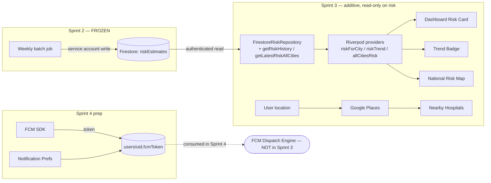

# ForeSeeMe — Sprint 3 Implementation Playbook

**Sprint focus:** the risk *consumption and visualization* layer — turn the Sprint 2 `riskEstimates` Firestore feed into live screens (dashboard risk card, trend, map), deliver the Health Resource Center, and lay the FCM groundwork for Sprint 4 — without touching the frozen Sprint 2 ML pipeline.

**Frozen baseline (do not modify):** Sprint 1 (auth, health profile, medication, local notifications, navigation guards) and Sprint 2 (data pipeline, Random Forest, FastAPI serving, weekly batch inference → Firestore `riskEstimates`). 141 backend tests passing. Sprint 2 is production-ready and frozen.

**Architectural invariants (unchanged):** Flutter reads risk **only** from Firestore `riskEstimates`; it never calls `/predict`. FastAPI stays internal. New work is additive and feature-first.

---

## 1. Sprint Objective

Make ForeSeeMe's intelligence visible and actionable to the end user. Until now the risk engine has run headless; Sprint 3 connects the Flutter client to the live `riskEstimates` feed and renders it as a dashboard risk card, a 3-state trend indicator, and a colored city-risk map — then completes the Health Resource Center (verified content, emergency dialing, nearby hospitals) and installs the notification *plumbing* (FCM token + preferences) that Sprint 4's alert engine will build on.

The sprint deliberately stops at notification **preparation**. The FCM dispatch/targeting/throttle engine is Sprint 4 and is explicitly out of scope here. By Sprint 3's end, a user can open the app and see their city's current environmental disease risk, its direction, the national picture on a map, and self-care resources — and the system knows how to reach them later.

---

## 2. Features

### F1 — Live Risk Binding (Firestore → Flutter)
- **Why:** every visual feature depends on real `riskEstimates` data flowing through the existing risk repository instead of the Sprint 1 fake.
- **Dependencies:** Sprint 1 risk feature (repository + providers); Sprint 2 `riskEstimates` collection.
- **Inputs:** authenticated user's city; `riskEstimates/{city}_{date}` documents.
- **Outputs:** `AsyncValue<RiskEstimateModel>` streamed to the UI with loading/empty/error/offline states.
- **User impact:** none directly visible, but unlocks everything below.
- **Technical impact:** one-line swap of `riskRepositoryProvider` (fake → Firestore), plus robust state handling and a Firestore read rule for `riskEstimates`.

### F2 — Dashboard Risk Card
- **Why:** the primary at-a-glance signal — the user's current city risk.
- **Dependencies:** F1; existing `dashboard` Home screen.
- **Inputs:** `riskForCityProvider(userCity)`.
- **Outputs:** a card showing city, risk level (label + icon + color), disease driver, confidence, and a grey "uncertain" treatment when `low_confidence` is true.
- **User impact:** immediate awareness of local risk on app open.
- **Technical impact:** presentation-only addition to the existing dashboard; no new data layer.

### F3 — Risk Trend Indicator (Rising / Stable / Falling)
- **Why:** direction is more actionable than a single value ("is it getting worse?").
- **Dependencies:** F1; an **additive read method** `getRiskHistory(city, weeks)` on the client risk repository.
- **Inputs:** trailing N weeks of `riskEstimates` for the user's city.
- **Outputs:** a direction enum + trend badge (label + arrow icon + color).
- **User impact:** sense of momentum, not just state.
- **Technical impact:** additive client read query (does not touch Sprint 2's write path or contract) + deterministic trend logic.

### F4 — National Risk Map (colored city zones)
- **Why:** SRS Module 3 — public-awareness visualization across all five cities.
- **Dependencies:** F1; additive `getLatestRiskAllCities()` read; Google Maps SDK + restricted key.
- **Inputs:** latest `riskEstimate` per city; city coordinates (`cities.yaml` parity).
- **Outputs:** a map screen with one color-coded zone/marker per city, tappable to a detail sheet.
- **User impact:** the national picture; situational awareness beyond their own city.
- **Technical impact:** Maps integration, key restriction, efficient latest-per-city query, render performance.

### F5 — Health Resource Center: content + emergency dial
- **Why:** SRS Module 4 — turn awareness into action; verified self-care + one-tap emergency access.
- **Dependencies:** none beyond app shell.
- **Inputs:** a curated, **sourced** static content library; emergency numbers (e.g., Rescue 1122).
- **Outputs:** a resources screen; one-tap `tel:` dialing via `url_launcher`.
- **User impact:** trusted guidance and fast help.
- **Technical impact:** new `resources` feature; static content shipped with the app (no backend).

### F6 — Health Resource Center: nearby hospitals (Google Places)
- **Why:** surface real facilities during elevated risk — Module 4's active-facilitator goal.
- **Dependencies:** F5; Google Places API + restricted key; user location.
- **Inputs:** user lat/lon; Places nearby-search for hospitals/clinics.
- **Outputs:** a cached list of nearby facilities, surfaced prominently when risk is High.
- **User impact:** fast path to care when it matters.
- **Technical impact:** Places integration, **result caching + quota guard** (cost control), key restriction.

### F7 — FCM Token Capture & Permission (Sprint 4 prep)
- **Why:** Sprint 4's alert engine needs a device token per user; capture it now, dispatch later.
- **Dependencies:** Sprint 1 auth; FCM SDK (already a dependency).
- **Inputs:** notification permission grant; FCM registration token.
- **Outputs:** `fcmToken` (and refresh handling) stored on `users/{uid}`; permission state.
- **User impact:** a one-time permission prompt; no alerts yet.
- **Technical impact:** new `alerts` feature (kept distinct from medication local reminders); a Firestore rule allowing a user to write their own token; token-refresh lifecycle.

### F8 — Notification Preferences
- **Why:** users should control which risk alerts they receive before any are sent.
- **Dependencies:** F7.
- **Inputs:** user toggles (e.g., per-disease, per-severity).
- **Outputs:** a `notificationPreferences` map on `users/{uid}`; a settings screen.
- **User impact:** control and trust ahead of Sprint 4.
- **Technical impact:** additive `users` field + settings UI; consumed (not enforced) until Sprint 4.

---

## 3. Architecture

**Backend changes:** essentially none — Sprint 2 is frozen. The only backend-adjacent work is **Firestore Security Rules** (infrastructure, not Sprint 2 code): allow any authenticated user to *read* `riskEstimates`, and allow a user to *write only their own* `users/{uid}.fcmToken` and `notificationPreferences`.

**Flutter changes:** all additive, feature-first. Extend `risk` (read methods, providers, risk card, trend badge, map screen, legend), wire the card into `dashboard`, add `resources` and `alerts` features.

**Firestore usage:** read existing `riskEstimates` (Sprint 2 writes it; Sprint 3 only reads). Additive fields on `users/{uid}`: `fcmToken`, `notificationPreferences`. **No new collections required.**

**APIs:** Google Maps SDK (F4), Google Places API (F6) — both client-side with restricted, quota'd keys. No internal API changes; the prediction contract is untouched.

**Data flow:**



---

## 4. Folder Changes

```
lib/features/
  risk/
    data/repositories/
      firestore_risk_repository.dart      # MODIFY: add getRiskHistory(), getLatestRiskAllCities()
      risk_repository.dart                # MODIFY: declare the two new read methods
    domain/providers/
      risk_providers.dart                 # MODIFY: flip to Firestore impl; add riskTrendProvider, allCitiesRiskProvider
    presentation/
      widgets/risk_card.dart              # NEW
      widgets/trend_badge.dart            # NEW
      widgets/risk_legend.dart            # NEW (colorblind-safe legend)
      screens/risk_map_screen.dart        # NEW
  dashboard/
    presentation/...                      # MODIFY: embed risk_card
  resources/                              # NEW feature
    data/  domain/  presentation/
      (content model, places_repository, resource_center_screen, hospital_list)
  alerts/                                 # NEW feature (FCM risk-alert prep; distinct from medication reminders)
    data/  domain/  presentation/
      (fcm_token_repository, notification_prefs_model, notification_settings_screen)

firebase/
  firestore.rules                         # MODIFY: riskEstimates read; users self-write token/prefs

android/app/  ios/Runner/                 # MODIFY: Google Maps API key config (restricted)

docs/
  SPRINT_3.md                             # this playbook
  architecture.md                         # MODIFY: add Sprint 3 data flow
test/features/
  risk/  resources/  alerts/              # NEW tests per prompt
```

No backend (`backend/`) code changes. No changes to Sprint 2 ML pipeline, contract, or batch job.

---

## 5. Prompt Breakdown

> Run in order. Prompts 5–6 (resources) and 7–8 (alerts) are internally sequential but independent of B. Each ends with: *"Stop after completing this task. Wait for review before continuing."*

### Prompt 1 — Live Risk Binding + State Handling
- **Objective:** flip `riskRepositoryProvider` from fake to `FirestoreRiskRepository`; handle loading/empty/error/offline robustly; update Firestore rules for `riskEstimates` reads.
- **Deliverables:** provider swap; empty-state ("no risk data yet for {city}") and error/offline handling; `firestore.rules` read rule; tests.
- **Acceptance criteria:** with seeded `riskEstimates`, the provider streams a real `RiskEstimateModel`; with none, it surfaces a clean empty state (no crash); offline uses Firestore cache.
- **Tests:** unit (provider override yields fake → swap proven); integration against Firestore emulator/test project (read works, rule denies unauthenticated); empty-city case.
- **Stop point:** live read verified, all states handled.
- **Git commit:** `feat(risk): bind risk feature to live Firestore riskEstimates with full state handling`

### Prompt 2 — Dashboard Risk Card
- **Objective:** render the user's current city risk on the existing Home dashboard.
- **Deliverables:** `risk_card.dart` (level label + icon + color, disease, confidence, low-confidence grey state); embedded in dashboard; `risk_legend.dart`.
- **Acceptance criteria:** card shows correct level/colour/label for seeded data; low-confidence renders the grey uncertainty treatment; **risk is never conveyed by colour alone** (label + icon present).
- **Tests:** widget tests for High/Medium/Low/low-confidence/empty states; golden test optional.
- **Stop point:** card live on dashboard across all states.
- **Git commit:** `feat(dashboard): add live risk card with accessible risk encoding`

### Prompt 3 — Risk Trend Indicator
- **Objective:** compute and display Rising/Stable/Falling from trailing history.
- **Deliverables:** additive `getRiskHistory(city, weeks)` read; `riskTrendProvider`; `trend_badge.dart`.
- **Acceptance criteria:** trend logic deterministic for known sequences; badge shows arrow + label + colour; insufficient history → "—/insufficient data", not a wrong arrow.
- **Tests:** unit on trend logic (rising/stable/falling/insufficient); widget test for badge; read-method test (additive, does not alter write path).
- **Stop point:** trend visible alongside the risk card.
- **Git commit:** `feat(risk): add risk trend indicator from trailing riskEstimates history`

### Prompt 4 — National Risk Map (colored city zones)
- **Objective:** map screen showing latest risk per city as color-coded, tappable zones.
- **Deliverables:** restricted Google Maps key config (Android/iOS); additive `getLatestRiskAllCities()`; `risk_map_screen.dart`; per-city colored marker/circle + detail sheet; legend.
- **Acceptance criteria:** all five cities render with correct colours; tapping a city opens its detail; **uses colored zones, not a density HeatmapTileProvider**; key is platform-restricted before merge.
- **Tests:** unit on latest-per-city query; widget test for marker colours; manual on a physical device (pan/zoom/tap); key-restriction checklist verified.
- **Stop point:** map renders live national risk.
- **Git commit:** `feat(risk): add national risk map with colored city zones`

### Prompt 5 — Resource Center: content + emergency dial
- **Objective:** verified static self-care content and one-tap emergency dialing.
- **Deliverables:** `resources` feature; sourced content model + library; `resource_center_screen`; `tel:` dialing via `url_launcher` (e.g., Rescue 1122).
- **Acceptance criteria:** content renders with visible sources/citations; emergency dial opens the dialer on a real device; no fabricated/unsourced medical claims.
- **Tests:** widget tests for content rendering; mock launcher asserts correct `tel:` intent; manual dial on device.
- **Stop point:** resource center usable with working dial.
- **Git commit:** `feat(resources): add health resource center with verified content and emergency dial`

### Prompt 6 — Resource Center: nearby hospitals (Places)
- **Objective:** show nearby facilities via Google Places, surfaced on High risk; cached and cost-guarded.
- **Deliverables:** restricted Places key; `places_repository` with caching + quota guard; `hospital_list`; prominence when risk is High.
- **Acceptance criteria:** nearby hospitals load for a known location; results cached (no duplicate calls within TTL); key restricted; graceful handling of denied location/no results.
- **Tests:** unit on repo with mocked Places (cache hit/miss, error); widget test for list/empty/error; manual on device.
- **Stop point:** nearby hospitals working and cached.
- **Git commit:** `feat(resources): add cached Google Places nearby-hospital lookup`

### Prompt 7 — FCM Token Capture & Permission (Sprint 4 prep)
- **Objective:** request notification permission and persist the FCM token to `users/{uid}`.
- **Deliverables:** `alerts` feature; `fcm_token_repository` (write + refresh handling); permission flow; `users` self-write rule; **no dispatch logic**.
- **Acceptance criteria:** on grant, a valid `fcmToken` is written to the user's doc; token refresh updates it; rule denies writing another user's token; declining permission degrades gracefully.
- **Tests:** unit on repo (mock FCM + Firestore); rule test (self-write allowed, cross-user denied); permission-denied path.
- **Stop point:** token captured and stored; nothing sent.
- **Git commit:** `feat(alerts): capture and persist FCM token for Sprint 4 alert delivery`

### Prompt 8 — Notification Preferences
- **Objective:** let users configure which risk alerts they want (consumed in Sprint 4).
- **Deliverables:** `notification_prefs_model`; `notificationPreferences` field on `users/{uid}`; `notification_settings_screen`.
- **Acceptance criteria:** preferences persist and reload; defaults sensible; settings reachable from profile/settings; schema documented for Sprint 4.
- **Tests:** unit on prefs serialization; widget test for the settings screen; persistence round-trip.
- **Stop point:** preferences settable and stored.
- **Git commit:** `feat(alerts): add notification preferences model and settings screen`

### Prompt 9 — Integration, Accessibility & E2E Hardening
- **Objective:** end-to-end verification, accessibility audit, and Sprint 3 documentation.
- **Deliverables:** integration tests across the risk-view vertical slice; colorblind-safe audit of every risk indicator; empty/offline/stale-data audit; updated `docs/architecture.md`; screenshots.
- **Acceptance criteria:** full slice (login → dashboard risk card → trend → map → resources) passes on a physical device; no risk signal relies on colour alone; offline shows cached data with a staleness hint; docs updated.
- **Tests:** integration/e2e on device; accessibility checklist signed off; offline/stale scenarios.
- **Stop point:** Sprint 3 exit criteria met.
- **Git commit:** `test(sprint3): end-to-end integration, accessibility audit, and documentation`

---

## 6. Engineering Risks

- **Technical — empty/stale risk data.** If the batch job hasn't run (or a city lacks an estimate), the UI must not crash. *Mitigation:* explicit empty/stale states (P1, P9); staleness hint when the latest estimate is old.
- **Integration — Firestore rules.** Wrong rules either block legitimate reads or over-expose writes. *Mitigation:* rule unit tests for `riskEstimates` read and `users` self-write (P1, P7).
- **UI — colour-only risk encoding (accessibility).** Red/Yellow/Green alone fails colorblind users — unacceptable for a health app. *Mitigation:* mandatory label + icon on every indicator; audit in P9.
- **UI — map UX.** A density heatmap over 5 points misleads; heavy markers janks low-end devices. *Mitigation:* colored zones not tiles (P4); lightweight rendering; test on a physical mid-range device.
- **Firebase — read cost & FCM lifecycle.** Heatmap/history reads can multiply; stale FCM tokens accumulate. *Mitigation:* efficient latest-per-city query + caching; token-refresh handling (P7).
- **Performance & cost — Google Places.** Uncached nearby-search is billable per call and the key is client-side. *Mitigation:* cache + TTL + quota guard; platform-restrict both Maps and Places keys before merge (P4, P6).

---

## 7. Testing Strategy (per prompt)

| Prompt | Unit | Integration | UI | Manual | Edge cases |
|---|---|---|---|---|---|
| P1 | provider swap | emulator read + rule | — | — | empty city, offline, denied read |
| P2 | — | — | card states | — | low-confidence, empty |
| P3 | trend logic | read method | trend badge | — | insufficient history, flat sequence |
| P4 | latest-per-city | — | marker colours | device pan/zoom/tap | missing city, key restricted |
| P5 | launcher intent | — | content render | real dial | unsourced content blocked |
| P6 | places repo (cache/error) | — | list/empty/error | device | no results, denied location |
| P7 | token repo | rule (self vs cross) | — | permission prompt | declined permission, token refresh |
| P8 | prefs serialize | — | settings screen | — | defaults, reload |
| P9 | — | full slice | accessibility audit | device e2e | offline, stale, colorblind |

---

## 8. Definition of Done (per prompt)

- **P1:** live `riskEstimates` read proven; all four states handled; rule tested. 
- **P2:** risk card live on dashboard for every state; accessible encoding. 
- **P3:** deterministic trend visible; insufficient-history handled. 
- **P4:** five cities render correct colours; tappable; key restricted; colored zones (not tiles). 
- **P5:** sourced content + working emergency dial on device. 
- **P6:** cached nearby hospitals; key restricted; graceful failures. 
- **P7:** valid token persisted + refreshed; cross-user write denied; no dispatch. 
- **P8:** preferences persist/reload; schema documented. 
- **P9:** e2e slice green on device; accessibility audit signed; docs/screenshots updated.

Every prompt: new code has tests, the suite is green, and the change is committed before the next prompt.

---

## 9. Sprint Exit Criteria

Sprint 3 is complete when, on a physical device: a user logs in and sees their city's **live** current risk (level, disease, confidence, low-confidence treatment) and its **trend**; opens a **map** showing color-coded risk for all five cities; uses a **Resource Center** with sourced content, working emergency dial, and (on High risk) nearby hospitals; and can grant notification permission (token persisted) and set notification **preferences** — with **no alert dispatch implemented**. Additionally: every risk signal is colorblind-safe; Maps/Places keys are platform-restricted and quota'd; Firestore rules tested; Sprint 2 untouched and still fully green; Sprint 3 tests green; docs and screenshots updated.

---

## 10. Deliverables

- **Screens/widgets:** risk card, trend badge, risk legend, national risk map, resource center, hospital list, notification settings.
- **Providers/queries:** `riskForCity`, `riskTrend`, `allCitiesRisk`; additive reads `getRiskHistory`, `getLatestRiskAllCities`.
- **Firestore:** read rule for `riskEstimates`; additive `users` fields `fcmToken`, `notificationPreferences`; tested rules. (No new collections.)
- **Integrations:** Google Maps + Places (restricted keys, cached Places).
- **Tests:** unit/integration/UI/e2e per the table; accessibility audit.
- **Docs/images:** this playbook, updated `architecture.md`, notification-preferences schema doc, Sprint 3 screenshots.

**Carried to Sprint 4:** the FCM **dispatch engine** (targeting by city + vulnerability, 24h throttle, audit log) consuming the tokens and preferences captured here — the novel contribution, built on this risk-view foundation.
