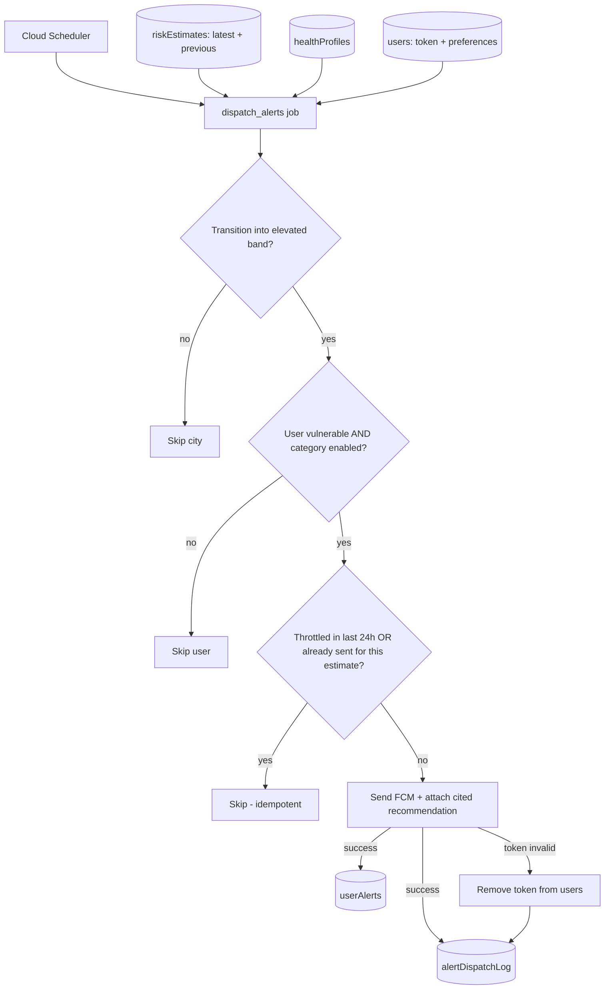
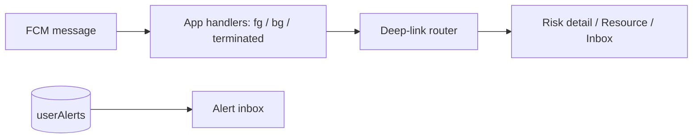

# ForeSeeMe — Sprint 4 Implementation Playbook

**Sprint focus:** turn ForeSeeMe from a prediction platform into a *proactive* health assistant — build the personalized FCM **alert dispatch engine** (the novel contribution), handle alerts in-app, and add a conservative, verified intelligence layer (recommendations, adherence insights, health summary) — all additive over the frozen Sprint 1–3 foundation.

**Frozen baseline (do not modify or refactor):** Sprint 1 (auth, profile, health profile, medication, adherence, dashboard, local notifications), Sprint 2 (risk engine, weather/AQI, `riskEstimates`, daily pipeline, indexes, rules), Sprint 3 (trend, national map, resource center, nearby hospitals, FCM token capture, notification preferences, security rules). Treat all as production-ready.

**Architectural invariants (unchanged):** Flutter never runs dispatch logic and never calls `/predict`; risk comes only from Firestore. The dispatch engine is a **backend scheduled job** (sibling of Sprint 2's `compute_risk`), using the firebase-admin service account. All Flutter work follows the established Clean Architecture (Presentation → Provider → Use Case → Repository interface → Repository impl → Firebase/APIs). No Firebase in UI. Every repository has an interface. DI via Riverpod.

**Per-prompt reporting contract (every prompt ends with this, then stops — do NOT commit):** Files created · Files modified · Architecture decisions · Tests added · Analyze result · Acceptance criteria met · Proposed commit message. *"Stop after completing this task. Do not commit. Wait for review before continuing."*

---

## 1. Sprint Objective

Make ForeSeeMe reach out, helpfully. Sprint 3 captured FCM tokens and notification preferences but sent nothing; Sprint 4 builds the engine that turns a rising city risk into a *personalized, consented, throttled* alert to exactly the users it matters to — and only when it matters. On top of delivery, the sprint adds a conservative intelligence layer: deterministic recommendations drawn from verified content, supportive adherence insights, and a personalized health summary. The defining design principles are **transition-triggered alerting** (no daily spam), **consent and throttle enforcement** (never over-notify), and **no fabricated medical content** (every recommendation is a cited lookup, never generated advice).

Out of scope (deferred): a full admin/analytics web panel and manual risk override remain future work; Sprint 4 surfaces only the operational metrics that fall out of the dispatch audit log.

---

## 2. Features

### F1 — Alert Targeting & Dispatch Contract
- **Why:** the engine, inbox, and tests must build against one frozen shape (targeting rules, throttle policy, two new collections).
- **Dependencies:** Sprint 2 `riskEstimates`; Sprint 3 `fcmToken` + `notificationPreferences`; Sprint 1 `healthProfiles`.
- **Inputs:** none (design artifact).
- **Outputs:** `alertDispatchLog` schema (ops audit + throttle ledger), `userAlerts` schema (in-app inbox), the targeting predicate, the throttle/idempotency policy, and a condition→risk-driver mapping table.
- **User impact:** none directly; de-risks everything below.
- **Technical impact:** frozen contract; new Firestore rules for both collections (engine writes via service account; user reads only own `userAlerts`).

### F2 — Personalized Dispatch Engine (backend job)
- **Why:** the core proactive capability and the project's novel contribution.
- **Dependencies:** F1; firebase-admin service-account pattern (Sprint 2 jobs).
- **Inputs:** latest + previous `riskEstimates` per city; `healthProfiles`; `users` (token + preferences); `alertDispatchLog`.
- **Outputs:** personalized FCM messages; a `userAlerts` doc per recipient; an `alertDispatchLog` entry per attempt.
- **User impact:** timely, relevant push alerts (e.g., asthma user in Lahore on a transition into High smog risk).
- **Technical impact:** new scheduled Cloud Run job `backend/app/jobs/dispatch_alerts.py`; transition detection; preference + vulnerability targeting; idempotent, audited sends.

### F3 — Throttle, Idempotency & Token Hygiene
- **Why:** the difference between a useful assistant and an uninstall — no spam, no duplicates, no dead tokens.
- **Dependencies:** F2.
- **Inputs:** `alertDispatchLog`; FCM send results.
- **Outputs:** enforced 24h per-(user, category) throttle; idempotent sends keyed to the specific risk estimate; invalid tokens pruned from `users`.
- **User impact:** at most one relevant alert per category per day; no repeats on job retry.
- **Technical impact:** throttle ledger checks; deterministic dispatch keys; FCM error handling (unregistered → remove token).

### F4 — In-App Alert Handling
- **Why:** a push is only useful if the app responds correctly when tapped or received in any state.
- **Dependencies:** Sprint 3 `alerts` feature; FCM SDK.
- **Inputs:** incoming FCM messages (foreground/background/terminated).
- **Outputs:** correct foreground display, background/terminated tap routing (deep link to risk detail or resource), Android notification channels.
- **User impact:** taps land on the right screen; foreground alerts are visible, not lost.
- **Technical impact:** message handlers + deep-link router; channel config; no business logic in handlers (delegated to providers/use cases).

### F5 — Alert Inbox / History
- **Why:** users miss pushes; they need a place to review past alerts.
- **Dependencies:** F1 (`userAlerts`); F2 (engine writes them).
- **Inputs:** `userAlerts/{uid}` documents.
- **Outputs:** an inbox screen (list, unread state, mark-read), reachable from the dashboard.
- **User impact:** a reliable record of health alerts.
- **Technical impact:** additive read repository + provider + screen; user-scoped Firestore rule.

### F6 — Personalized Recommendation Engine (deterministic, cited)
- **Why:** turn risk into action without fabricating medical advice (Rule 11).
- **Dependencies:** Sprint 3 verified Resource Center content; Sprint 1 `healthProfiles`; current `riskEstimates`.
- **Inputs:** user conditions × current risk drivers.
- **Outputs:** a small set of **cited** advisories looked up from the verified content library; surfaced on the dashboard and embedded in alert payloads.
- **User impact:** concrete, trustworthy "what to do" guidance.
- **Technical impact:** deterministic mapping (no generation); a documented rule table; routes to professional/emergency help rather than improvising.

### F7 — Adherence Intelligence (supportive)
- **Why:** help users improve adherence without shame or alarm.
- **Dependencies:** Sprint 1 `adherenceLogs`.
- **Inputs:** historical adherence records.
- **Outputs:** descriptive patterns (streaks, strongest/weakest times of day, missed-dose patterns) framed supportively.
- **User impact:** gentle, useful self-knowledge — never failure scoring.
- **Technical impact:** read-only analytics use case over existing data; supportive copy guidelines enforced in UI.

### F8 — Health Insights Summary
- **Why:** a single personalized view tying risk + adherence together.
- **Dependencies:** F6, F7.
- **Inputs:** current risk, recommendations, adherence insights.
- **Outputs:** a non-diagnostic insights card/screen.
- **User impact:** an at-a-glance "how am I doing / what should I watch" view.
- **Technical impact:** composition over existing providers; descriptive only, with appropriate disclaimers.

### F9 — Production Hardening & Engagement Safeguards
- **Why:** prove the pipeline end-to-end and protect against alert fatigue and cost.
- **Dependencies:** F2–F8.
- **Inputs:** the full system.
- **Outputs:** e2e tests, fatigue/cost audit, deep-link analytics hooks, Sprint 4 docs.
- **User impact:** a reliable, respectful assistant.
- **Technical impact:** integration tests on a test project/emulator; dispatch cost/volume review; documentation.

---

## 3. Architecture

**Backend changes (additive, sibling to Sprint 2 jobs):** new scheduled job `backend/app/jobs/dispatch_alerts.py` plus supporting modules (`targeting.py`, `throttle.py`, `messaging.py`). Reuses the firebase-admin service account. No changes to the ML pipeline, prediction contract, or `compute_risk`.

**Flutter changes (additive, feature-first):** extend the Sprint 3 `alerts` feature (message handling, inbox); add an `insights` feature (recommendations, adherence intelligence, health summary). No Firebase in UI; all via providers → use cases → repositories.

**Firestore usage:** read existing `riskEstimates`, `healthProfiles`, `users`, `adherenceLogs`. **New collections:** `alertDispatchLog` (service-account write; ops/throttle) and `userAlerts/{uid}/...` (service-account write, user-owned read; inbox). Additive rules only; existing rules untouched.

**APIs:** FCM send via firebase-admin (backend). No client API changes.

**Dispatch data flow:**



The app side only *receives*:



---

## 4. Folder Changes

```
backend/app/jobs/
  dispatch_alerts.py        # NEW: scheduled entrypoint (sibling of compute_risk.py)
  alerting/
    targeting.py            # NEW: transition + vulnerability + preference predicate
    throttle.py             # NEW: 24h throttle + idempotency keys
    messaging.py            # NEW: firebase-admin FCM send + token-invalid handling
    recommendation_lookup.py# NEW: deterministic condition×driver → cited content
backend/tests/
  test_targeting.py  test_throttle.py  test_dispatch_alerts.py   # NEW

firebase/firestore.rules    # MODIFY: alertDispatchLog (svc write), userAlerts (svc write / owner read)

lib/features/
  alerts/                   # EXTEND (Sprint 3 feature)
    data/repositories/      # NEW: user_alerts_repository (read inbox)
    domain/                 # NEW: alert handling use cases, providers
    presentation/
      alert_inbox_screen.dart        # NEW
      services/fcm_message_handler.dart  # NEW (fg/bg/terminated)
      services/alert_deep_link_router.dart # NEW
  insights/                 # NEW feature
    data/  domain/  presentation/
      recommendation_repository.dart       # NEW (reads verified content)
      adherence_insights_use_case.dart     # NEW (read-only analytics)
      recommendations_card.dart            # NEW
      adherence_insights_card.dart         # NEW
      health_insights_screen.dart          # NEW
  dashboard/presentation/   # MODIFY: surface recommendations + insights entry points

docs/
  SPRINT_4.md               # this playbook
  alert_dispatch_design.md  # MODIFY/NEW from Prompt 1
  recommendation_rules.md   # NEW: the cited mapping table
test/features/alerts/  test/features/insights/   # NEW
```

No changes under `backend/ml/`, no changes to Sprint 1–3 feature internals beyond additive surfacing on the dashboard.

---

## 5. Prompt Breakdown

> Run in order. Each ends with the per-prompt reporting block (§ preamble) and stops without committing. Phases A→B→C→D are dependency-ordered.

### Prompt 1 — Alert Targeting & Dispatch Contract (design/contract)
- **Objective:** freeze the dispatch design: `alertDispatchLog` + `userAlerts` schemas, the targeting predicate (transition into elevated band × vulnerability × enabled category), the throttle/idempotency policy, the condition→risk-driver mapping, and additive Firestore rules.
- **Deliverables:** `docs/alert_dispatch_design.md`; `docs/recommendation_rules.md` (cited mapping); rule additions for both collections; no engine code.
- **Acceptance criteria:** every schema field, the idempotency key (derived from the specific risk estimate), and the throttle window are documented; mapping entries are cited; rules grant service-account writes and owner-only reads.
- **Tests:** rule tests (service write allowed; user reads only own `userAlerts`; cross-user denied).
- **Stop point:** contract frozen; engine and inbox can build against it.

### Prompt 2 — Personalized Dispatch Engine (core)
- **Objective:** implement the scheduled job: detect transitions, target vulnerable + consenting users, send personalized FCM with a cited recommendation, write `userAlerts` + `alertDispatchLog`.
- **Deliverables:** `dispatch_alerts.py`, `targeting.py`, `messaging.py`, `recommendation_lookup.py`; container/job entrypoint wiring (sibling of `compute_risk`).
- **Acceptance criteria:** an asthma user in a city transitioning into High smog risk receives one personalized alert; a user with no matching condition or a disabled category receives none; every attempt is audited and produces an inbox doc on success.
- **Tests:** unit on targeting (vulnerable vs not, enabled vs disabled, transition vs steady); dispatch test with mocked FCM + Firestore (send + audit + inbox written).
- **Stop point:** engine sends correctly on a single run against seeded data.

### Prompt 3 — Throttle, Idempotency & Token Hygiene
- **Objective:** guarantee no spam, no duplicates on re-run, and no dead tokens.
- **Deliverables:** `throttle.py` (24h per-(user,category) window; idempotency key check against `alertDispatchLog`); FCM token-invalid handling that prunes `users`.
- **Acceptance criteria:** re-running the job for the same estimate sends nothing new (idempotent); a second qualifying event within 24h is suppressed; an unregistered-token response removes the token and is logged.
- **Tests:** unit on throttle window + idempotency key; token-pruning test on mocked FCM error; re-run produces zero duplicate sends.
- **Stop point:** dispatch is safe to schedule.

### Prompt 4 — In-App Alert Handling
- **Objective:** handle FCM messages in foreground/background/terminated and route taps via deep links; configure Android channels.
- **Deliverables:** `fcm_message_handler.dart`, `alert_deep_link_router.dart`; channel config; handlers delegate to providers (no logic in handlers).
- **Acceptance criteria:** foreground alerts display; background/terminated taps open the correct screen (risk detail / resource / inbox); no Firebase or business logic inside UI handlers.
- **Tests:** unit on the router (payload → destination); widget/handler tests for the three states (mocked messages).
- **Stop point:** alerts behave correctly in all app states on a device.

### Prompt 5 — Alert Inbox / History
- **Objective:** an in-app inbox reading `userAlerts` with unread state and mark-read.
- **Deliverables:** `user_alerts_repository`, providers, `alert_inbox_screen.dart`; dashboard entry point + unread badge.
- **Acceptance criteria:** delivered alerts appear in the inbox; unread→read persists; user sees only their own alerts; empty state handled.
- **Tests:** unit on repo/provider; widget tests for list/unread/empty; rule-scoped read test.
- **Stop point:** inbox live and user-scoped.

### Prompt 6 — Personalized Recommendation Engine (deterministic, cited)
- **Objective:** map {user conditions × current risk drivers} to cited advisories from the verified content library; surface on dashboard and in alert payloads.
- **Deliverables:** `recommendation_repository.dart`, `recommendations_card.dart`; consumes `docs/recommendation_rules.md`.
- **Acceptance criteria:** recommendations are looked up (never generated), always carry a source, and route to professional/emergency help where appropriate; no condition match → a safe generic, sourced default.
- **Tests:** unit on the deterministic mapping (known inputs → expected cited entries); widget test for the card; assertion that no free-text medical claims are produced.
- **Stop point:** trustworthy recommendations visible.

### Prompt 7 — Adherence Intelligence (supportive)
- **Objective:** descriptive adherence analytics framed supportively.
- **Deliverables:** `adherence_insights_use_case.dart`, `adherence_insights_card.dart`.
- **Acceptance criteria:** computes streaks/time-of-day patterns/missed patterns correctly; copy is supportive (no failure scoring, no shaming); read-only over existing logs.
- **Tests:** unit on analytics math (fixtures); widget test; copy-tone review checklist.
- **Stop point:** insights informative and kind.

### Prompt 8 — Health Insights Summary
- **Objective:** compose risk + recommendations + adherence into one non-diagnostic summary.
- **Deliverables:** `health_insights_screen.dart`; dashboard entry point.
- **Acceptance criteria:** summary is descriptive (not diagnostic), carries appropriate disclaimers, and reuses existing providers (no new data sources).
- **Tests:** widget tests across data states; disclaimer presence asserted.
- **Stop point:** unified insights view live.

### Prompt 9 — Production Hardening & Engagement Safeguards
- **Objective:** prove the alert pipeline end-to-end; audit fatigue and cost; document Sprint 4.
- **Deliverables:** e2e tests across detect→send→receive→inbox (test project/emulator); a fatigue/cost audit note; deep-link analytics hooks; updated `docs/architecture.md` + screenshots.
- **Acceptance criteria:** full pipeline passes on a test project; throttle/transition rules verified end-to-end (no spam under repeated runs); cost/volume reviewed; docs updated.
- **Tests:** integration/e2e; repeated-run spam check; accessibility pass on new screens.
- **Stop point:** Sprint 4 exit criteria met.

---

## 6. Engineering Risks

- **Alert fatigue / spam [CRITICAL].** Re-sending on every run drives uninstalls and viva criticism. *Mitigation:* transition-triggering + 24h throttle + idempotency keyed to the estimate (P1–P3); repeated-run spam test (P9).
- **Duplicate sends on retry [HIGH].** Job re-runs or partial failures double-notify. *Mitigation:* deterministic idempotency key checked against `alertDispatchLog` before send (P3).
- **Fabricated medical content [HIGH].** Generated advice is unsafe and violates Rule 11. *Mitigation:* deterministic, cited lookups only; tests assert no free-text claims (P6).
- **Wellbeing harm from engagement tactics [HIGH].** Guilt/alarm-based nudges hurt vulnerable users. *Mitigation:* supportive-copy guidelines + tone review (P7, P8); calm alert copy.
- **Consent/preference bypass [HIGH].** Sending a disabled category breaks trust and rules. *Mitigation:* preference enforcement in targeting + tests (P2).
- **Stale FCM tokens / delivery failures [MEDIUM].** Dead tokens waste sends and skew metrics. *Mitigation:* prune on unregistered-token error (P3).
- **Cost/volume of scheduled sends [MEDIUM].** Unbounded fan-out is billable. *Mitigation:* targeting narrows recipients; cost audit (P9).
- **Architecture drift [MEDIUM].** Dispatch logic leaking into Flutter. *Mitigation:* engine stays backend; handlers delegate to providers; analyze clean each prompt.

---

## 7. Testing Strategy (per prompt)

| Prompt | Unit | Integration | UI | Manual | Edge cases |
|---|---|---|---|---|---|
| P1 | schema/key derivation | rules | — | — | cross-user read denied |
| P2 | targeting predicate | engine + mocked FCM/Firestore | — | seeded run | no-match user, disabled category, steady risk |
| P3 | throttle + idempotency | re-run dedup | — | — | within-24h, invalid token, partial failure |
| P4 | deep-link router | message handling | fg/bg/terminated | device taps | unknown payload, no route |
| P5 | repo/provider | rule-scoped read | inbox states | — | empty, unread→read |
| P6 | deterministic mapping | — | card | — | no condition match, missing source |
| P7 | analytics math | — | card | — | sparse logs, perfect adherence |
| P8 | composition | — | summary states | — | missing data, disclaimers |
| P9 | — | full e2e | accessibility | device | repeated-run spam, cost/volume |

---

## 8. Definition of Done (per prompt)

- **P1:** contract + rules frozen and rule-tested. 
- **P2:** correct, audited, personalized send on a seeded run. 
- **P3:** idempotent + throttled + token-pruning proven. 
- **P4:** correct behaviour in all three app states; no logic in handlers. 
- **P5:** user-scoped inbox with unread/read persistence. 
- **P6:** cited, non-generated recommendations surfaced. 
- **P7:** correct, supportive adherence insights. 
- **P8:** non-diagnostic summary with disclaimers. 
- **P9:** e2e green, no spam under repeated runs, docs updated.

Every prompt: new code fully tested, `flutter analyze`/backend lint clean, report block produced, **not committed** — awaiting review.

---

## 9. Sprint Exit Criteria

Sprint 4 is complete when: the scheduled engine sends **personalized, consented, transition-triggered** alerts to vulnerable users and to no one else; repeated runs and within-window events produce **no spam and no duplicates**; invalid tokens are pruned; users receive and re-read alerts via correct in-app handling and an inbox; recommendations are **cited lookups, never generated**, and route to professional help appropriately; adherence/health insights are **supportive and non-diagnostic**; the full pipeline passes e2e on a test project; cost/fatigue audited; Sprint 1–3 untouched and still green; analyze clean; docs and screenshots updated.

---

## 10. Deliverables

- **Backend:** `dispatch_alerts` job + `targeting`/`throttle`/`messaging`/`recommendation_lookup` modules; tests.
- **Firestore:** `alertDispatchLog`, `userAlerts` collections + additive rules (tested).
- **Flutter:** FCM message handlers, deep-link router, alert inbox, recommendations card, adherence insights card, health insights screen; tests.
- **Docs/images:** this playbook, `alert_dispatch_design.md`, `recommendation_rules.md` (cited), updated `architecture.md`, fatigue/cost audit note, Sprint 4 screenshots.

**Carried beyond Sprint 4 (future):** admin/analytics web panel and manual risk override; broader recommendation content; engagement analytics dashboards.
